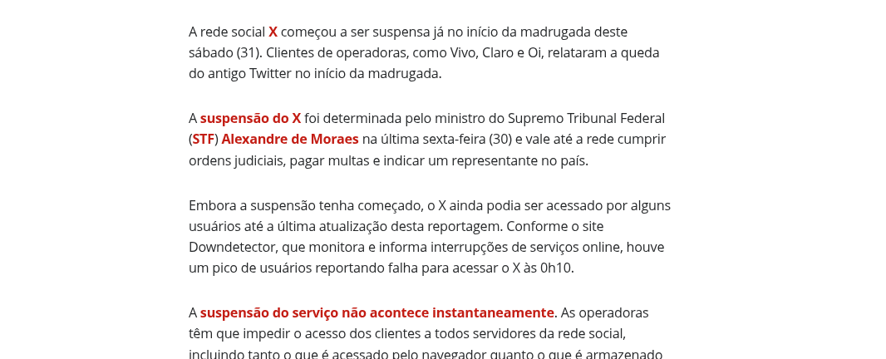
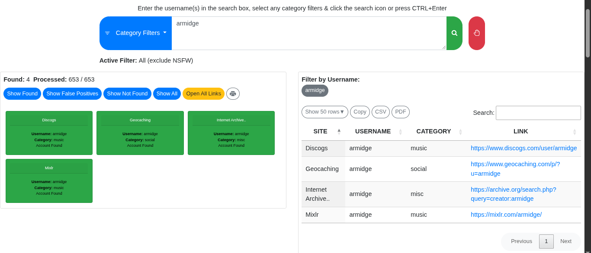

# O mínimo que você precisa saber sobre OPSEC & anonimato

Esse pequeno artigo é a segunda parte, um tanto mais prática, de um outro artigo: [*Por que a sua privacidade é tão importante*](https://github.com/Armidge/Lost-Found/blob/main/Articles/Por%20que%20a%20sua%20privacidade%20%C3%A9%20t%C3%A3o%20importante.md), que tratava de privacidade, do anonimato e da importância dessas coisas para uma sociedade mais livre e segura.

## Um quartinho sobre OPSEC!

Do princípio, [OPSEC](https://www.fortinet.com/br/resources/cyberglossary/operational-security) é um acrônimo para Operations Security ou Segurança de Operações, originada em algum momento durante a guerra do Vietnã, graças aos esforços de uma [força-tarefa apelidada de Purple Dragon](https://www.nsa.gov/portals/75/documents/news-features/declassified-documents/cryptologic-histories/purple_dragon.pdf), do exército norte-americano. Conforme a NSA, OPSEC seria "a disciplina que transforma conscientização em ação, reduzindo vulnerabilidades antes que elas sejam descobertas e exploradas", ou ainda:

"OPSEC é um processo sistemático que pode ser aplicado por organizações para negar a potenciais adversários informações sobre capacidades e intenções, por meio da identificação, do controle e da proteção de informações e evidências, geralmente não classificadas, do planejamento e da execução de atividades sensíveis e classificadas." ([*The National OPSEC Program*](https://media.defense.gov/2021/Jun/29/2002751705/-1/-1/0/THE_NATIONAL_OPSEC_PROGRAM.PDF), NSA.)

Dito de outra forma, OPSEC é saber o que esconder, como esconder e o que emular — quando necessário. São as roupas que escondem a vergonha do homem. É o segredo nunca revelado. É o que só contamos a pessoas específicas, de forma parcial e estratégica. É ser maquiavelicamente reservado quanto aos próprios dados e informações, sobre o que é mostrado, dito: por palavras, coordenadas, metadados, códigos, imagens ou áudios, ou até mesmo, gestos, formas de ser.

Assim, deve-se saber que OPSEC é útil e indispensável tanto ao sujeito que almeja estar a uns dois, três ou cem passos (a depender da aplicação dessas técnicas/táticas) à frente de um agente malicioso, quanto a estados-nações e empresas de pequeno, médio ou grande porte, que certamente têm muito a perder. Para esse artigo, estou pensando em pessoas, de usuários comuns àqueles que já têm algum conhecimento disto que estamos tratando.

## Sobre anonimato e afins.

Com base em [Pfitzmann e Hansen](https://dud.inf.tu-dresden.de/literatur/Anon_Terminology_v0.28.pdf), anonimato é [o estado de] não ser identificável dentro de um conjunto de sujeitos. Definição que é, em parte, relativa, já que nunca se é “anônimo” em absoluto, mas indistinguível dentro de um grupo. Digo que a regra de ouro é essa: *passe despercebido*.

Você pode ser um usuário comum e não dar a mínima para sua privacidade, seguir usando os mesmos programas e navegadores, acessando as mesmas redes e compartilhando as mesmas coisas, e isso só mostra que você não leu a [primeira parte desse artigo](https://github.com/Armidge/Lost-Found/blob/main/Articles/Por%20que%20a%20sua%20privacidade%20%C3%A9%20t%C3%A3o%20importante.md) (ou não a levou a sério). Ou pode aplicar todos os procedimentos e técnicas e táticas que listarei por aqui em algum lugar. Todas mesmo. E chamará mais atenção (será menos anônimo) do que um usuário médio, na rede aberta de um shopping.

Na *matrix*, o ideal é se misturar à multidão. Usando o que é necessário apenas quando necessário, com inteligência. Se você usar muito do que tem: VPNs e Proxys, Tor Browser, alguma distro Linux, como Tails ou Whonix... o anonimato acaba, e [*eles* te pegam](https://pt.wikipedia.org/wiki/Agente_Smith).

Assim, OPSEC torna-se tão fundamental ao anonimato quanto ambos são à privacidade.

## O que você precisa saber.

Comecemos por algo mais... pessoal, **estilometria. A minuciosa análise de palavras, frases e textos para a identificação de um autor, bem como quaisquer outras informações relevantes, que sirvam à Inteligência**. A forma como você digita, o tamanho das frases, as palavras que sempre utiliza, os vícios de linguagem, o espaçamento, a acentuação, a pontuação, as letras em maiúsculo e minúsculo, como inicia e termina um parágrafo. Mesmo os erros de ortografia.

A partir duma dessas análises, somada à biometria comportamental, é possível não só identificar uma pessoa, como seu gênero, idade, padrão-perfil psicológico, dispositivo (se mobile ou pc), nível de alfabetização, etc., para além de tudo que se pode obter a partir da análise direta do conteúdo das mensagens, o que está escrito de fato.

Pense bem no que digita, em como digita e, principalmente, onde e para quem digita. Mude seu estilo de escrita sempre que achar necessário, alternando entre os tons, traduzindo e retraduzindo ou parafraseando, errando essa ou aquela palavra de propósito, etc.

**Não reutilize identidades, nicks/nomes/usernames** que possam te comprometer de alguma forma. Usar sempre o mesmo nome em jogos é uma coisa; usá-lo, também, para acessar o admin panel de sua empresa ou do lugar em que trabalha, ou em qualquer fórum da Dark Web, é outra.

**Cuidado com screenshots (prints da tela)**, em qualquer dispositivo e app. Tire um tempo para reparar se há nomes de usuários, mensagens sensíveis, ícones demais na barra de notificações ou de tarefas, favoritos fixados, histórico de navegação, informações do sistema, endereços de email ou IPs, etc. e, na dúvida, borre ou não compartilhe, verificando sempre os metadados.

**Metadados. Todos os arquivos que criamos, baixamos e acessamos possuem metadados**, dos textos simples em txt aos pdfs, vídeos e imagens. Esses dados podem ser inseridos, removidos ou editados, e incluir nomes de usuário, emails, comentários, informações do dispositivo, horários e fusos horários, geolocalização, etc., como demonstrado abaixo:

```console
┌─[parrot@parrot]─[~/Documents/Security/CTFs/thm-osintchallengeiv]
└──╼ $exiftool task-3/landmark-1763035881792.JPG
File Name                       : landmark-1763035881792.JPG
File Size                       : 2.8 MB
File Type                       : JPEG
MIME Type                       : image/jpeg
Make                            : Canon
Camera Model Name               : Canon PowerShot SX160 IS
Orientation                     : Horizontal (normal)
Software                        : Microsoft Windows Live Photo Gallery14.0.8051.1204
Modify Date                     : 2017:07:04 11:10:36
Exposure Time                   : 1/1250
F Number                        : 8.0
ISO                             : 160
Date/Time Original              : 1980:01:01 00:00:22
Create Date                     : 1980:01:01 00:00:22
Flash                           : Off, Did not fire
Warning                         : [minor] Adjusted MakerNotes base by 76
Auto Rotate                     : Rotate 90 CW
Camera Temperature              : 26 C
File Number                     : 116-2546
Image Unique ID                 : 2ac8ae078b62d35033b95ba82b3b9d45
Faces Detected                  : 0
Time Zone                       : +00:00
Exif Image Width                : 3456
Exif Image Height               : 4608
GPS Version ID                  : 2.3.0.0
Creator Tool                    : Microsoft Windows Live Photo Gallery14.0.8051.1204
Focal Length                    : 5.0 mm (35 mm equivalent: 28.1 mm)
Light Value                     : 15.6

```

Há diversas formas de ver, editar e remover metadados, e uma delas é a ferramenta [Exiftool](https://exiftool.org/). Alguns sites também fazem o mesmo, mas precisaríamos subir o arquivo ao servidor de terceiros. E esse é um ponto crítico de atenção, já que esses arquivos podem ser acessados e manipulados por outras pessoas.

A **Área de Transferência** (mais comum no Android e Windows), o histórico do que copiamos e colamos, também deve, sempre, ser verificado e limpo, a fim de que nada ou muito pouco reste das coisas e textos (emails, usuários, senhas, talvez?) que copiamos e que, do contrário, seriam facilmente vistos por qualquer um que, por essa ou aquela razão, soubesse o que está procurando.

**Cuidado ao escrever e fazer anotações em folhas de papel, post-its e semelhantes ou documentos**. Senhas, emails, pins, dados e informações sensíveis, credenciais de acesso em geral, sobretudo em ambientes que são frequentados por outros, como um escritório. E por cuidado, quero dizer: evite. Se possível, não faça.

**O descarte dessa papelada também deve ser adequado: triture, queime, risque, manche**. [Dumpster Diving ou Trashing](https://pt.wikipedia.org/wiki/Dumpster_diving) é real e não deve ser subestimado; [alguém pode vasculhar o lixo](https://www.youtube.com/watch?v=tbAPZSdOvSs) de uma vítima em potencial em busca de qualquer coisa que não tenha encontrado online, ou que levaria muito mais tempo para ser descoberto.

De igual maneira, **o descarte de componentes de hardware como unidades de armazenamento (cartões de memória, pendrives, HDs, SSDs) deve ser cuidadosamente realizado**, com essas peças sendo formatadas/criptografadas e, posteriormente, queimadas ou trituradas, a fim de que a recuperação de quaisquer arquivos seja quase impossível.

Ainda sobre lixo: **nada num sistema operacional é verdadeiramente excluído depois que a lixeira é esvaziada**. Soluções como o [BleachBit](https://www.bleachbit.org/) (Windows/Linux) e o [Shreddit](https://play.google.com/store/apps/details?id=com.palmtronix.shreddit.v1&hl=pt) (Android) tentam, através de uma série de técnicas como sobrescrição, truncamento e renomeação de arquivos, impedir que os dados excluídos sejam encontrados e recuperados através de softwares forenses.

**Criar senhas fortes e ter boas noções a respeito de criptografia também são conhecimentos essenciais à privacidade e segurança**. Utilize sempre senhas ou passphrases (uma combinação de quatro ou mais palavras) de no mínimo 8 caracteres/palavras, fortes, de [alta entropia](https://www.keepersecurity.com/blog/pt-br/2024/03/04/password-entropy-what-it-is-and-why-its-important/). Não as reutilize. Ative a 2FA, Autenticação de Dois Fatores. E se quiser salvá-las, não anote! Use um cofre/gerenciador de senhas como o [Proton Pass](https://proton.me/pt-br/pass) ou o [KeePass](https://keepass.info/), ainda que seu sistema seja criptografado.

Sim, criptografado. **Criptografar, no mínimo, o seu sistema principal é uma ótima prática para manter seus dados seguros**. Especialmente se eles forem muito, muito sensíveis. Saiba mais sobre criptografia [aqui](https://www.fortinet.com/br/resources/cyberglossary/what-is-cryptography).

**Agentes diversos (maliciosos ou não) também conseguem saber quem você é, o que acessa e como acessa qualquer coisa através do seu endereço IP**, algo como a sequência de números que identifica o seu dispositivo dentro de sua rede e a sua rede dentro da internet. Pense nas implicações disso, para além das óbvias, como a possibilidade de alguém saber mais ou menos ou, por vezes, exatamente onde você está.

Ou querer e ter o poder, de fato, de dizer o que você pode ou não utilizar, seja uma rede social como o Facebook, seja o Youtube ou o Google. O Discord ou o [Twitter, atual X](https://g1.globo.com/tecnologia/noticia/2024/08/31/rede-social-x-suspensa-no-brasil.ghtml):




Mas saiba que **há uma infinidade de contramedidas a esses bloqueios**, das quais, uma das mais notórias é, certamente, o [Tor Browser](https://www.torproject.org/). O Tor é o navegador mais adequado (não o único) para acesso à Rede Tor, anônima e distribuída, onde qualquer um é, aliado a bons conhecimentos técnicos (e incluo OPSEC aqui), anônimo. Amplamente usado por profissionais da área de TI/SI, ativistas, jornalistas e pessoas dos mais diversos lugares do mundo, para os mais diversos propósitos. Sem rastreamento, vigilância ou censura.

Como medidas ou contramedidas mais simples, pode-se sempre configurar um proxy (p. ex., [ProxyChains](https://www.kali.org/tools/proxychains-ng/)), alterar algum DNS ou ativar uma VPN como o [Proton VPN](https://protonvpn.com/pt-br). Alguns desses servidores são gratuitos ou oferecem planos com alguma limitação, outros são pagos. Uns são mais confiáveis e privados do que outros.

Já é sabido que deixamos rastros e impressões por onde quer que passemos, no mundo físico ou no virtual. Se num temos CPF, RG e as digitais de cada dedo, no outro, temos um IP, User-Agent, Device ID e... digitais, também. **Fingerprints, que são necessariamente isso: um conjunto de dados e padrões, são rastros e impressões que deixamos em cada site que acessamos** e que, convenientemente, podem ser reunidos, articulados e seguidos.

Você tem um computador com peças específicas, com um monitor de resolução específica, e acessa sempre a mesma rede. São quase sempre os mesmos sites (que trocam dados entre si). Fontes, GPU, fuso horário. São mil maneiras de rastreá-lo, de identificá-lo. Eles sabem até o hardware que você utiliza.

Sim, Browser Fingerprints podem quebrar todo o seu anonimato. Mas a aplicação de muito do que foi exposto aqui pode te ajudar a... passar mais despercebido. Sites como o [Browserleaks](https://browserleaks.com/), [Cover Your Tracks](https://coveryourtracks.eff.org/) e o [My Fingerprint](https://amiunique.org/fingerprint) são capazes de mostrar o quanto de nós e do nosso dispositivo está sendo vazado.

Como últimos cuidados, **repense o uso de redes sociais** e pense duas vezes antes de postar alguma coisa, sobretudo em contas abertas e com um grande número de seguidores, pelas razões e motivos que já foram discutidos anteriormente. Mesmo as pessoas que você segue e que seguem você, seus stories, comentários, curtidas, e tantos outros elementos como esses, podem ser usados contra você ou alguém que você conhece.

Sites como o [WhatsMyName Web](https://whatsmyname.app/) e ferramentas como o [Sherlock](https://github.com/sherlock-project/sherlock) são capazes de reunir uma quantidade impressionante de dados com base em um username, como demonstrado:



Só o WhatsMyName foi atrás do user fornecido 653 vezes! A saída do Sherlock foi igualmente numerosa, embora aqui tenha sido resumida:

```console
┌─[parrot@parrot]─[~]
└──╼ $sherlock armidge
[*] Checking username armidge on:

[+] 1337x: https://www.1337x.to/user/armidge/
[+] 7Cups: https://www.7cups.com/@armidge
[+] Airliners: https://www.airliners.net/user/armidge/profile/photos
[+] Apple Developer: https://developer.apple.com/forums/profile/armidge
[+] Apple Discussions: https://discussions.apple.com/profile/armidge
[+] Archive.org: https://archive.org/details/@armidge
[+] Bandcamp: https://www.bandcamp.com/armidge
[+] Championat: https://www.championat.com/user/armidge
[+] Code Snippet Wiki: https://codesnippets.fandom.com/wiki/User:armidge
[+] CodeSandbox: https://codesandbox.io/u/armidge
...

```

Lembre-se, também, de **sempre checar as credenciais de acesso das câmeras de segurança** que possa ter em casa. Embora não costumem explodir como em Watch Dogs, são alvos relativamente fáceis quando conectados à rede. Um endereço IP, às vezes um username e uma senha padrão e pronto! Alguém tem acesso à sua vida privada. O [Shodan Search](https://www.shodan.io/) tem um catálogo inteiro de dispositivos conectados à internet, dos mais diversos tipos. Incluindo câmeras. Câmeras que podem ser acessadas.

**Não conecte qualquer dispositivo ou acessório ao seu computador/celular**. [Pendrives específicos](https://shop.hak5.org/products/usb-rubber-ducky) podem não só conter arquivos maliciosos como, também, serem programados desde o hardware para causar danos ou realizar exfiltrações e infiltrações. Até [cabos USB, também específicos](https://shop.hak5.org/products/omg-cable), podem ser usados para esses propósitos.

**Cuide bem de suas entradas USB**. Principalmente em ambientes públicos e/ou corporativos.

Por fim, **há uma infinidade de alternativas ao Google (do navegador ao buscador)**. Embora nem todas sejam tão responsivas quanto o que entregam, asseguram algum nível (geralmente a mais) de privacidade. O [DuckDuckGo](https://duckduckgo.com/), o [Brave](https://search.brave.com/), o [Ahmia](https://ahmia.fi/) e o [Torch](http://xmh57jrknzkhv6y3ls3ubitzfqnkrwxhopf5aygthi7d6rplyvk3noyd.onion/) são exemplos disso. Os dois primeiros são navegadores/buscadores. Esses dois últimos, para buscas na rede Tor. Como navegador, o [Firefox](https://www.firefox.com/pt-BR/) também é uma ótima alternativa.

De momento, isso é só. E o mínimo. Links úteis e recursos: [_04xOPSEC](https://github.com/Armidge/_04xOPSEC).
