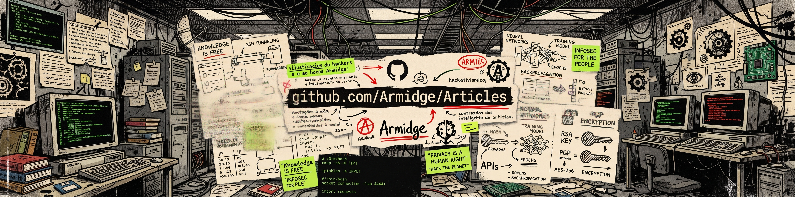

# Articles

Uma série de artigos curtos, técnicos e objetivos a respeito das engrenagens e arquiteturas intrínsecas ao universo da tecnologia, com ênfase em Segurança da Informação, Cibersegurança, Hacking, privacidade, anonimato e OPSEC (Segurança de Operações).

